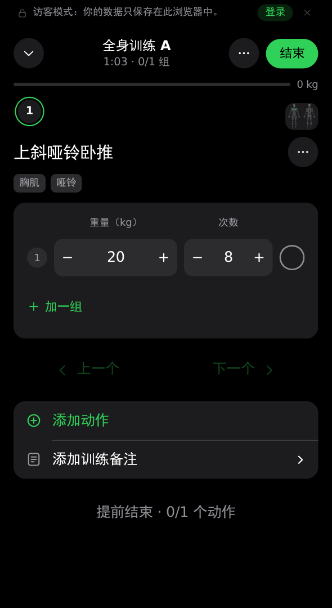
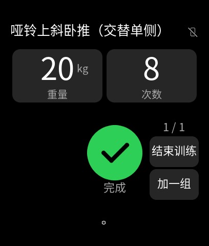
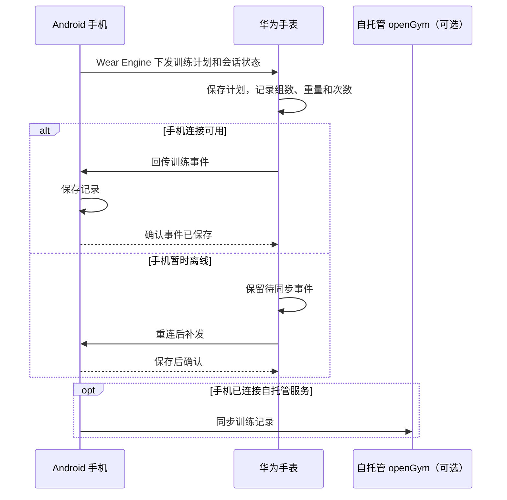

# openGym for Huawei Watch

openGym 的第三方华为手表适配，面向 Android 手机与圆表、方表等华为手表，提供训练计划、记录和休息计时的双向同步。

**基于 Duarte Santos 的 [openGym](https://github.com/DuarteSantos8/openGym) 项目开发；本版本为第三方华为手表 / HarmonyOS 适配。** 原项目提供训练管理、进阶规则、自托管服务及 Apple Watch 版；本分支新增华为 Wear Engine 通信桥接和鸿蒙手表端。维护者与上游作者、华为均为独立关系。

[开发文档](docs/harmony/README.md) · [兼容性](docs/harmony/COMPATIBILITY_ZH.md) · [修复进度](docs/HARMONY_OPEN_BUGS_ZH.md) · [接手记录](docs/HARMONY_HANDOFF_PROMPT_ZH.md) · [上游](https://github.com/DuarteSantos8/openGym)

**可交给 Agent 自签打包。** 在本机准备工具链和自己的签名资料后，复制[打包提示词](docs/harmony/AGENT_PACKAGING_ZH.md)，Agent 可完成源码检出、APK/HAP 构建、签名、验签和 SHA-256 校验。[与上游 1.4.5 的差异](docs/harmony/FORK_DIFFERENCES_ZH.md)

## 项目特点

- **Android ↔ 华为手表双向训练。** 手机下发今日计划、轮换计划和可选训练；手表记录组数、重量、次数、计时动作和 RPE/RIR，并回传手机。
- **离线记录与恢复。** 训练事件先落盘再发送，确认后才清理；断连时保留记录。手表采用双文件状态存储，避免 Lite KV 单值容量限制，退出重开后恢复计划。
- **训练接收反馈。** 手机开始训练时请求唤起手表，手表收到新训练并保存后进入训练界面、长震一次；重复快照不重复震动。
- **双向休息控制。** 共享休息截止时间，提供 ±15 秒、暂停/继续和跳过；手机通过优先小消息同步休息状态，旧快照顺序保护避免恢复旧计时。
- **手表训练交互。** 前台常亮、触屏数值调整、重量小数调整、加一组、休息结束长震，以及动作位置同步。表冠旋转控制与触控锁已取消。
- **动作演示与多语言。** 手机转码并发送动作帧，手表保留上一组完整动画直至替换完成。手表界面保留 12 种语言。
- **沿用 openGym 的训练基础。** 训练计划、历史记录、进阶规则、身体数据、本地使用和可选自托管服务继续使用原项目实现。

## 手机与手表界面示意

| Android 手机训练页 | 华为 Lite Wearable 训练页 |
| --- | --- |
|  |  |

左侧为手机共用训练界面预览，右侧为 DevEco Lite Wearable 预览。两张图均使用合成训练数据。

## 手机与手表如何联动



休息计时和结束训练可在两端联动。自托管服务由手机访问，手表与手机通过 Wear Engine 通信。

## 当前适配状态

当前代码基于上游 [openGym 1.4.5](https://github.com/DuarteSantos8/openGym/releases/tag/v1.4.5)，并已合入上游 `main` 至 `e4a68a94c` 的文档更新。

项目面向华为手表多型号适配，圆形和方形屏幕均在目标范围。当前实现使用 HarmonyOS Lite Wearable FA JS 与 Wear Engine；已在 **HUAWEI WATCH FIT 5 Pro** 验证计划下发、保存恢复、表冠退出与前台常亮。其他型号的运行时、分辨率、圆屏安全区域和设备能力仍需逐项适配与验证，见[兼容性记录](docs/harmony/COMPATIBILITY_ZH.md)。

2026-11-14 已合并上游 `main` 至 `68dad18f8`。合并后手机 7862、服务端 804、手表 130 项回归通过，手机 APK 已安装。合并版手表包随后出现启动黑屏；已定位并修正压缩步骤丢失 `ViewModel` 返回值的问题，新增返回值回归和原生启动检查，手表回归增至 131 项。启动与 SDK 回调修正版已通过实机复测，用户确认恢复。

训练接收反馈、双向休息控制、128×128 动画和计划列表滚动提示已实现。实际震动、双端计时和偶发退表盘继续验证。华为心率功能已取消，既有历史记录保留；平台权限条件见[心率说明](docs/harmony/HEART_RATE_GUIDE_ZH.md)，当前验证状态见[缺陷进度](docs/HARMONY_OPEN_BUGS_ZH.md)。

休息结束系统通知已取消，当前保留手表应用内倒计时、前台震动和常亮。系统训练、热量及华为运动健康写入待后续开发。本分支维护 Android 与华为手表；iPhone / Apple Watch 用户可使用[上游版本](https://github.com/DuarteSantos8/openGym)。

## 使用与构建

当前提供源码和本地测试构建流程。手机 APK 与手表 HAP 需要匹配的包名、签名身份及 Wear Engine 配置；设备绑定调试 Profile、签名私钥和本机身份文件留在本地。

```bash
git clone https://github.com/Starlordzz/openGym-harmonywatch.git
cd openGym-harmonywatch
cd frontend
npm ci
npm run dev
```

网页开发服务可单独运行；华为手表通信通过 Android 原生桥接。连接自己的服务见[自托管指南](docs/SELF_HOSTING.md)，Android 和手表构建见[开发指南](docs/HARMONY_FIT.md)及[脚本索引](scripts/harmony/README.md)。

1.4.5 源码版的 Android APK 和 Lite Wearable HAP 可按[自签名打包指南](docs/harmony/SELF_SIGNING_ZH.md)在本机生成。

### 给 Agent 的打包提示词

```text
请读 docs/harmony/AGENT_PACKAGING_ZH.md，使用 OPENGYM_PACKAGING_CONFIG 指向的本机配置，完成 fork v1.4.5 的 Android APK 和华为 Lite Wearable HAP 自签打包。按指南完成非交互构建与验签，将已验证的包、SHA256SUMS 和对应源码提交记录交付到配置的本机输出目录。
```

完整提示词、配置样例和验收条件见 [Agent 自签打包](docs/harmony/AGENT_PACKAGING_ZH.md)。首次账号授权与设备登记由用户在本机完成，私钥、密码、调试 Profile 和设备资料通过本机文件提供。

```bash
# 手表纯逻辑、协议、存储与交互回归（当前 146 项）
node --test frontend/harmony/tests/*.test.js
# 公钥身份推导检查
node --test scripts/harmony/watch-peer-identity.test.mjs
# 手机界面与同步回归
cd frontend
npm test
# 服务端回归
cd ../api
node --test
```

手表构建使用 DevEco Studio 的 Lite Wearable SDK；release 流程复用 SDK 自带 Terser 优化 ES5 JS，逐份检查 **48 KB** 上限，再生成 BIN/HAP。签名和校验脚本见 `scripts/harmony/`。

## 目录

| 路径 | 内容 |
|---|---|
| `frontend/src/` | React 手机界面、训练状态与同步逻辑 |
| `frontend/android/` | Android 容器、HuaweiWatchPlugin 与 Wear Engine 桥接 |
| `frontend/harmony/watch/` | 手表模板源码；修改入口 |
| `frontend/harmony/tests/` | 手表状态机、协议、存储及页面回归 |
| `harmonywatch/` | DevEco 工程；从模板暂存，执行编译 |
| `scripts/harmony/` | 构建、签名、校验、诊断工具及说明 |
| `docs/harmony/` | 华为手表文档索引与多型号兼容性记录 |
| `docs/HARMONY_*` | 保持固定路径的需求、进度和开发记录 |
| `api/`、`web/`、`catalogue/` | 上游服务、网页部署和训练目录 |
| `harmonywatch/artifacts/` | 本地安装包、日志和验证证据，Git 忽略 |

仓库保留部分上游平台源码与历史文档，用于来源追溯和上游合并。本分支的开发入口与维护范围见 [AGENTS.md](AGENTS.md)。

## 源码、署名与许可

- 原作者：**Duarte Santos**；上游：<https://github.com/DuarteSantos8/openGym>。感谢原项目及其贡献者。
- 本分支修改包含华为手表应用、Android 通信桥接及相关工具，修改记录见 Git 历史与进度文档；2026-11-14 本轮改动见[交接记录](docs/HARMONY_HANDOFF_PROMPT_ZH.md)。
- 代码沿用 **AGPL-3.0-or-later**，以 [LICENSE](LICENSE) 和 [NOTICE.md](NOTICE.md) 为准。本版本对应源码位于[当前仓库](https://github.com/Starlordzz/openGym-harmonywatch)，分发构建时须提供对应提交的源码和必要构建说明。
- Gym visual 图片、动画独立授权，范围见[素材声明](catalogue/media/NOTICE.md)；华为 SDK 保留[原许可与来源说明](frontend/harmony/watch/entry/src/main/js/default/vendor/README.md)。
- 密钥、密码、调试 Profile、用户训练数据和安装包留在本地；配置从已提交示例复制，凭据通过本机文件或环境变量提供。

功能差异与验证状态见 [Apple Watch 与华为手表功能对比](docs/harmony/WATCH_FEATURE_COMPARISON_ZH.md)。
